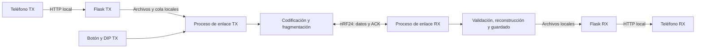

# Arquitectura y mapa del software

Referencia de la versión probada el 26 de noviembre de 2026. El código de los
algoritmos proviene del equipo; la integración conserva sus formatos y añade
validación, cola local, transporte y presentación. Los ensayos instrumentados
están enlazados en el [índice](README.md).

## Recorrido de una imagen

1. La carga y la selección quedan en la microSD de TX. El original se conserva.
2. La web encola una copia de imagen/modo/bits. El botón usa la imagen guardada
   y toma modo/bits del DIP en el momento de pulsar. Comparten un bloqueo local.
3. TX codifica, reconstruye localmente y mide calidad. Genera metadatos con
   tamaños, dimensiones y SHA-256 esperado. Automático compara candidatos.
4. El flujo es longitud de JSON de 4 bytes big-endian + JSON UTF-8 + binario
   codificado. Todo viaja por nRF24, incluidos metadatos y respuestas.
5. RX reúne fragmentos, verifica CRC-32, decodifica, comprueba hashes/dimensiones
   y guarda mediante archivo temporal y reemplazo atómico.
6. Solo entonces devuelve confirmación final de aplicación. La web RX lee el
   historial local y sirve la imagen como PNG de vista previa.

Cada Raspberry tiene su propio AP, servidor y almacenamiento. No hay servidor
central ni llamadas HTTP entre las Raspberry en la operación del producto.

## Archivos de producción

| Archivo, desde la raíz | Qué hace y qué conviene conservar |
|---|---|
| `integracion/web/__main__.py` | CLI de Waitress; rol, dirección, puerto y directorio de datos |
| `integracion/web/app.py` | API, validación de BMP/PGM, token de página, selección, compresión local, galerías y borrado |
| `integracion/web/templates/index.html` | Estructura TX/RX, formularios, progreso y galerías |
| `integracion/web/static/app.js` | Guardar antes de enviar, consultar estado, mostrar métricas y controlar acciones de la página |
| `integracion/web/static/app.css` | Presentación adaptable al teléfono |
| `integracion/web/trabajos.py` | JSON atómico, heartbeat reciente, exclusión mediante `ocupado` y cola compartida con botón |
| `integracion/enlace.py` | Propietario único del radio; trabajos TX, receptor, reconstrucción, diagnóstico y `Controls` opcional |
| `transmision/codecs.py` | Adaptador HUF2/QPG1, modo automático, hashes, MSE/PSNR y tiempos locales |
| `transmision/algoritmos/algoritmo_sin_perdidas/compresor_sin_perdidas.py` | Árbol y códigos Huffman del equipo; CLI integrada |
| `transmision/algoritmos/algoritmo_sin_perdidas/descompresor_sin_perdidas.py` | Tabla/árbol, validación de códigos y decodificación acelerada, compatible con HUF2 |
| `transmision/algoritmos/con_perdidas/codificador.py` | Cuantización uniforme, empaquetado QPG1, profundidades 1–7 |
| `transmision/algoritmos/con_perdidas/decodificador.py` | Desempaquetado y reconstrucción; integración usa modo estricto |
| `transmision/algoritmos/con_perdidas/metricas.py` | Funciones del equipo; integración usa MSE sobre original y reconstrucción locales |
| `transmision/archivos.py` | START/DATA/FIN/ACK, stop-and-wait, CRC-32, reintentos y deduplicación |
| `transmision/enlace.py` | Adaptador pyRF24, FIFO, alternancia envío/escucha y contadores hardware |
| `transmision/enlace_imagenes.json` | Configuración del enlace real de imágenes, común en ambos extremos |
| `transmision/radio.py` | Validación común de argumentos y apagado; su inicialización de prueba mínima es otra ruta |
| `integracion/web/comu-web@.service` | Servicio web por usuario |
| `integracion/web/comu-enlace@.service` | Servicio de radio por usuario; GPIO se habilita explícitamente |
| `integracion/web/red_local.py` | Comprobaciones, ensayo, persistencia y recuperación de AP mediante root |
| `integracion/web/diagnostico_ap.py` | Observador de conexión, DHCP, HTTP y eventos, sin activar redes |
| `integracion/web/comu-red-*.service`, `comu-red-recuperar@.timer` | Recuperación y observación del ensayo inicial de cinco minutos |
| `integracion/instalar_imagenes.sh` | Instalación del paquete probado, respaldo y espera de disponibilidad; no cambia Wi-Fi |
| `integracion/hw_test.py` | Prueba aislada de entradas/salidas; abre GPIO al ejecutar/importar, no radio |

Las CLI de `transmision/transmisor/`, `transmision/receptor/`, `diagnostico.py`
y `config.json` pertenecen a la **prueba mínima de texto**. No iniciar junto con
el enlace de imágenes. Sus parámetros iniciales no sustituyen los de
`enlace_imagenes.json`. `codificacion/` queda como orientación al código integrado.

## Formatos e integridad

- HUF2 codifica todos los bytes de la fuente, incluidos cabecera y paleta. Un
  contador de símbolos de 16 bits admite los 256 valores; cada código puede
  ocupar hasta 255 bits. La reconstrucción sin pérdidas debe ser idéntica.
- QPG1 cuantiza píxeles grises y reconstruye por punto medio. Devuelve PGM;
  conservar dimensiones no significa conservar todos los píxeles originales.
- Automático compara Huffman y siete cuantizaciones y elige el menor candidato
  que sea exacto o alcance PSNR ≥ 25 dB. Puede tardar más en preparar.
- Los originales admitidos son BMP/PGM gris de hasta 320 × 240 y 2 MiB. El flujo
  de radio completo tiene otro límite: **256 KiB**, incluidos metadatos. Se
  rechaza si no cabe; no se reduce silenciosamente la imagen.

La [especificación de tramas](../transmision/protocolo/README.md) detalla campos,
estados y reintentos. El CRC de radio, el CRC-32 del flujo y SHA-256 verifican
capas diferentes. `ACK=True` del radio no significa imagen validada y guardada.

## Almacenamiento local

Base por defecto: `~/.local/share/proyectocomu-web`, independiente del checkout.
La web y el enlace de una misma placa deben compartir usuario y directorio.

| Ruta relativa | Contenido |
|---|---|
| `imagenes/` | Fuentes TX; UUID + nombre seguro evita colisiones |
| `seleccion.json` | Última selección guardada |
| `cola/<trabajo>.json` | Solicitud inmutable de transmisión |
| `cola/*.interrumpido` | Trabajos pendientes al arrancar; no se reenvían solos |
| `ocupado` | Exclusión creada con `O_EXCL`; no borrar durante un envío |
| `enlace.json` | Estado real del proceso, progreso, heartbeat y últimas métricas |
| `resultados/<trabajo>.json` | Resultado final TX, también si falló |
| `codificacion.json`, `codificada/` | Resultado de prueba local opcional en TX |
| `recibidas/<sesion>.bmp` o `.pgm` | Imágenes reconstruidas en RX |
| `recepciones/<sesion>.json` | Métricas e identidad de cada recepción |
| `ultima_recepcion.json` | Referencia a la última; la galería busca una alternativa si se borró |

Los escritores de JSON usan temporal, `fsync` y reemplazo atómico para que los
lectores no vean medias escrituras. La web genera vistas PNG al leer una fuente
o recepción; ese PNG no es lo que se envía por el radio.

## Estado, tiempos y métricas

El worker publica heartbeat cada segundo en un hilo separado. La web considera
disponible un estado reciente de menos de cinco segundos y un proceso fuera de
inicio/fallo/detención. Así, codificar Huffman no hace parecer muerto al proceso.
Los estados principales son `esperando`, `escuchando`, `codificando`, `enviando`,
`recibiendo`, `completado`, `error`, `error_radio` y `detenido`.

`total_tx_ms` mide preparación, envío y confirmación final desde TX; no incluye
cargar la foto ni el refresco del navegador. `compresion_ms` y
`preparacion_tx_ms` son mediciones locales; en automático existe además
`seleccion_automatica_ms`. `recepcion_ms` en RX llega hasta el inicio del callback
de reconstrucción; `descompresion_ms` incluye reconstruir, validar y guardar la
imagen. No se restan relojes absolutos de placas diferentes.

MSE y PSNR se calculan en TX con la fuente y su reconstrucción local; RX recibe
esos valores y verifica el archivo. `psnr_tx_db=null` con MSE cero representa
calidad exacta, mostrada como infinito. Los dB son PSNR, no RSSI ni potencia.
Los reintentos hardware y de aplicación son contadores distintos; no cuentan
reinicios. Los bytes de tramas de aplicación no incluyen todo el tráfico físico
de auto-ACK. **BER físico no está disponible**.

## Decisiones que no deben perderse al mantener el código

- Mantener una sola escritura de radio en vuelo. La limpieza de FIFO y de
  interrupciones antes de `write()` corrigió ACK desfasados observados en pruebas.
- Conservar ACK final después de reconstruir y guardar; nunca sustituirlo por
  progreso al 100 % o por ACK hardware.
- No reintroducir un plazo global implícito de 60 s. Las esperas por fragmento,
  límite de reintentos y caducidad por inactividad de RX siguen siendo necesarios.
- LED y botón pertenecen al worker con `--gpio`; Flask no debe abrirlos. La
  [guía de hardware](hardware/guia_led_botones.md) precisa qué señal está implementada.
- No ejecutar a la vez la prueba remota `~/prueba_radio.py`, la prueba mínima,
  `hw_test.py` y el worker si compiten por el mismo recurso.

Las pruebas automatizadas están en `transmision/test_minimo.py`,
`transmision/test_imagenes.py`, `integracion/web/test_web.py`,
`test_red_local.py` y `test_diagnostico_ap.py` dentro de `integracion/web/`.
Los canales artificiales pertenecen a tests; no existe simulación de transmisión
como resultado real en producción.
