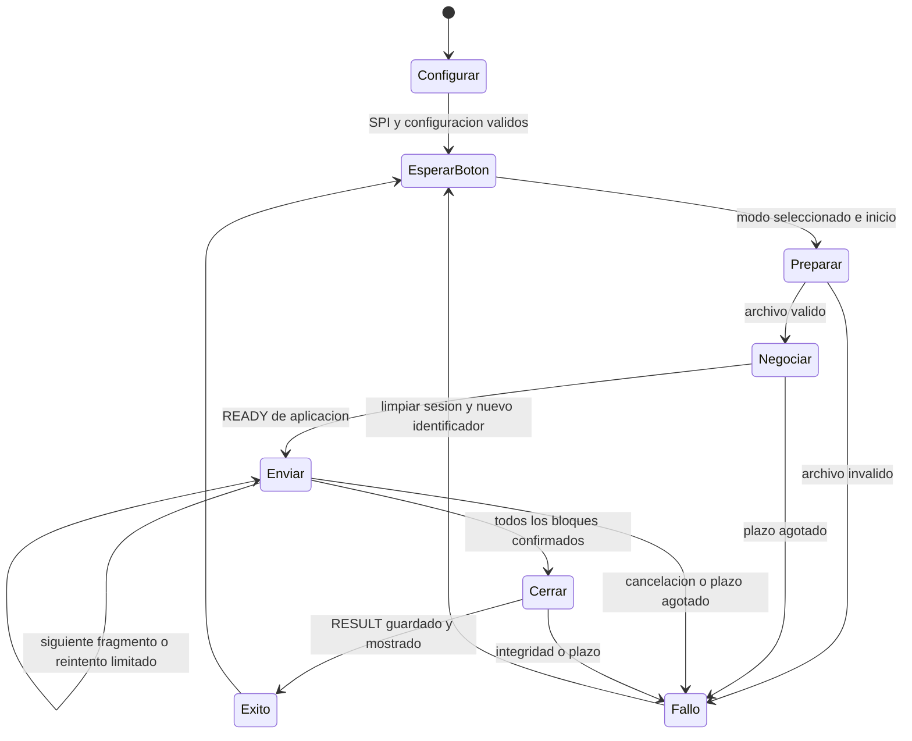
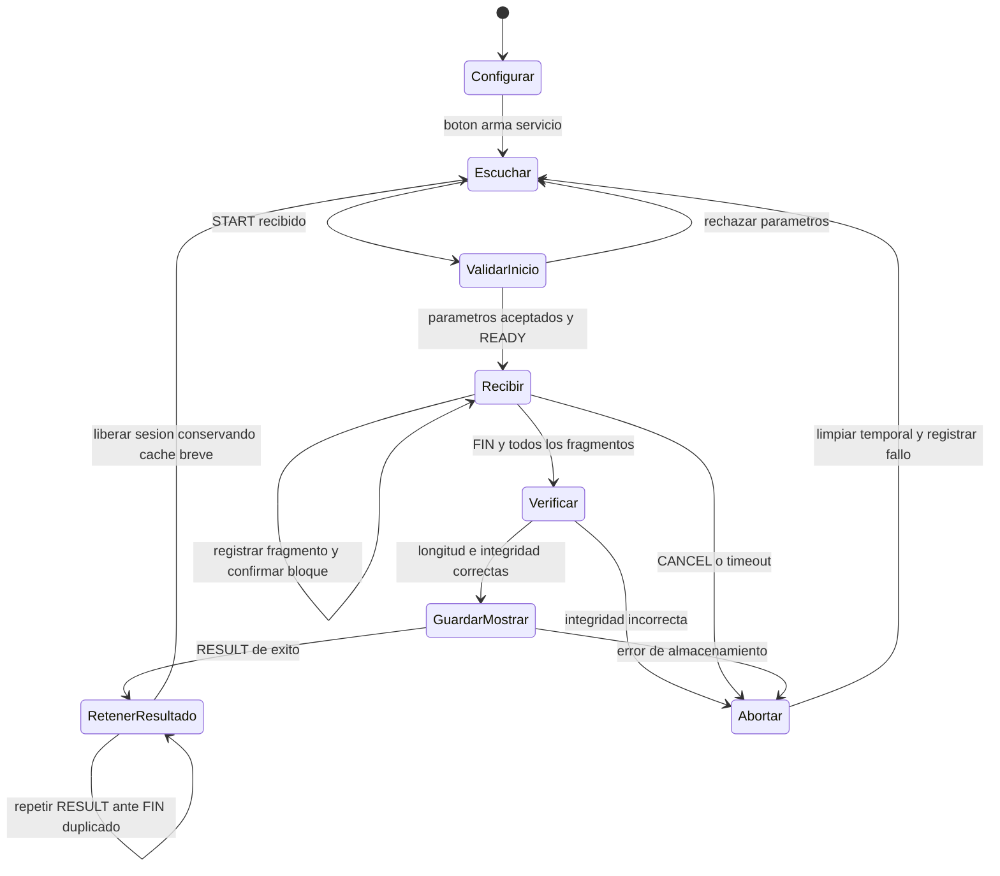

# Arquitectura y protocolo conceptual

Diseño propio basado en [consigna y documentación Nordic/RF24](../../documentacion/investigacion/fuentes.md). No es una implementación ni una especificación binaria definitiva.

## Recorrido y responsabilidades

TX selecciona modo antes del botón, valida imagen y conserva original. El codificador futuro entrega bytes, identificador de algoritmo, parámetros y tamaño esperado de reconstrucción. El protocolo transporta ese flujo sin conocer su algoritmo. RX verifica flujo comprimido antes de descodificar, valida dimensiones, almacena y muestra. Para la primera validación de archivos se omite temporalmente el codificador en ambos extremos.

## Estados preliminares

## Contrato conceptual de mensajes

| Mensaje | Contenido lógico | Tratamiento |
|---|---|---|
| START / META | Versión, identificador de sesión, modo/algoritmo/parámetros, formato, ancho/alto, profundidad, tamaño original y codificado, tamaño de fragmento, cantidad y digest del flujo | Puede necesitar varios paquetes; numerar metadatos y comprobar integridad completa antes de reservar buffer |
| READY / REJECT | Sesión y aceptación o motivo | ACK de aplicación tras validar límites; TX no envía datos antes de READY |
| DATA | Sesión, índice y bytes del fragmento | Indexación desde cero, longitud final conocida; no sumar duplicados |
| BLOCK_ACK / NACK | Sesión, bloque, bitmap o siguiente índice requerido | RX confirma almacenamiento en memoria; software repone huecos, no confunde ausencia de ACK con pérdida segura de datos |
| FIN | Sesión, longitud total y digest | RX acepta solo cuando todos los fragmentos están presentes y digest coincide |
| RESULT | Sesión, estado, tiempos RX, digest, almacenamiento y despliegue completados | Confirmación extremo a extremo; TX registra resultado y emite RESULT_ACK |
| CANCEL / RESULT_ACK | Sesión y razón o cierre | Cancelación idempotente; liberar memoria y volver a escucha |

Identificador propuesto: entero de 32 bits generado con aleatoriedad del sistema y verificación de no reutilización reciente; no es medida de seguridad. La versión binaria fijará tamaños, orden de bytes, CRC/digest y límites de longitud. Para cálculos se ensaya cabecera DATA de 8 bytes (tipo/versión, banderas, sesión 4 bytes, índice 2 bytes) dejando 24 bytes de datos; es hipótesis revisable, no formato aprobado. Rechazar una sesión que exceda el índice representable en vez de desbordarlo. No confiar en metadatos recibidos para reservar memoria sin límites.

Integridad propuesta: CRC de radio de dos bytes, CRC-32 del flujo codificado completo y SHA-256 del archivo original para auditoría sin pérdidas. CRC no autentica emisor ni protege contra manipulación deliberada. Fragmentos META deben permitir incluir estos campos. Guardar digest esperado de referencia en el banco de evaluación; RX no puede calcular PSNR sin el original correspondiente. [Evaluación](../pruebas/README.md)

## Fiabilidad, acceso y plazos

Acceso al medio: punto a punto semidúplex, un solo iniciador de archivos. TX solicita sesión, envía un bloque y cede turno al RX para una respuesta de aplicación explícita. Auto-ACK radio permanece habilitado para cada paquete; no requiere que Linux responda dentro del plazo hardware. No se atribuye CSMA/CA ni ausencia de colisiones con otras redes. Elegir canal después de caracterizar interferencia y documentar configuración fija; backoff limitado puede ayudar sin convertirse en garantía de acceso.

Propuesta inicial de ventana: un bloque de 16 fragmentos, respuesta explícita y reenvío selectivo de ausentes. Usar un paquete en vuelo al instrumentar contadores hardware; ampliar streaming solo después de validar contabilidad y FIFO. El ACK automático no basta para confirmar que el host vació FIFO y aceptó el bloque. El bitmap de aplicación detecta pérdidas de host o duplicados que sobreviven al radio.

Plazos tentativos de software: 1 s para respuesta START/READY, 0,5 s para respuesta de bloque, máximo tres reintentos de aplicación por mensaje/bloque, inactividad RX 3 s y presupuesto global desde pulsación de 60 s. Cada reintento consume el presupuesto restante; ajustar con latencia medida. No usar estos plazos para deducir tasa alcanzada. Negociación/codificación debe reservar tiempo de cierre, guardado y despliegue; abortar si el presupuesto no permite continuar.

Si se pierde READY, START repetido para la misma sesión devuelve READY sin borrar progreso. Si un DATA se repite, comparar posición y contenido, no añadirlo al final. Sesiones ajenas reciben BUSY o se descartan; no mezclarlas. Si FIN se pierde o RESULT no llega, repetir FIN limitado: RX conserva resultado de sesión cerrada y reenvía RESULT, sin descodificar ni guardar otra vez. Retener caché de cierres por un plazo superior a la ventana de reintentos prevista; fijarlo al cerrar especificación. Una sesión fallida reinicia desde cero con ID nuevo, no tiene reanudación persistente aún.

Responsabilidades automáticas: estructura RF, CRC por paquete, ACK y reintentos hardware, PID. Responsabilidades del programa: admisión de sesión, metadata, fragmentos, mapa de recepción, reintentos de aplicación, digest de archivo, deadlines, cancelación, persistencia, despliegue y métricas. Validar todas con fallos inyectados antes de medir alcance.
